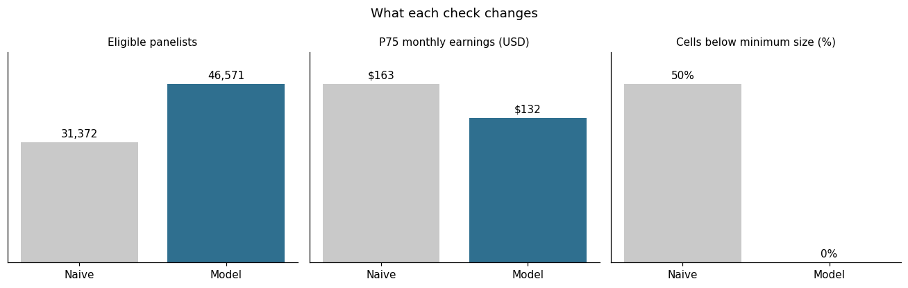
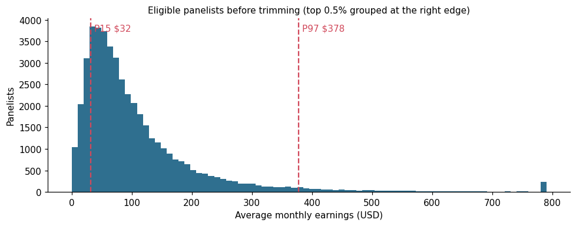
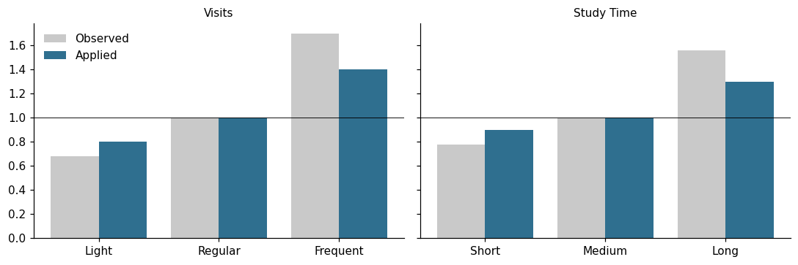

# How much could I earn? Building a defensible earnings estimator

A case study in turning messy reward data into a range a company can safely show to prospects.

> **Everything in this repository is synthetic.** The setting (a paid research panel for professionals), the data, the names and every number are invented and generated by `data/generate.py`. What is real is the kind of problem and the way of working through it.



## The business question

A paid research panel wants a calculator on its sign-up page. A prospect picks their profession, country, how often they would visit and how much time they would spend on studies, and sees a monthly and yearly earnings range.

Two things matter:

1. **The range has to be true for typical panelists**, not for a few outliers. Over-promising costs trust and drives complaints.
2. **Every input has to move the number.** Each extra question lowers sign-ups, so it has to earn its place.

## Approach

| Step | What it does | SQL |
|---|---|---|
| 1. Current role | One row per panelist with their current profession | `01_current_role.sql` |
| 2. Eligibility | Not retired, not blocked, and active in the last 6 months (5+ visits or 4+ completed studies) | `02_eligibility.sql` |
| 3. Earnings | Average monthly earnings in USD over the last 18 months, adjusted for tenure | `03_panelist_earnings.sql` |
| 4. Trimming | Keep panelists between the 15th and 97th percentile | `04_trim.sql` |
| 5. Cells | P25, P50 and P75 by profession and market, borrowing the profession-wide bands when a cell is too small | `05_cells.sql` |
| 6. Levers | Visit frequency and study time, measured on real behavior and then damped toward 1.0 | `06_levers.sql` |
| 7. Estimates | Every combination a prospect can choose, with a minimum and bands that never cross | `07_estimates.sql` |
| 8. Peer benchmarks | Median earnings and activity per profession, shown next to the estimate | `08_peer_benchmarks.sql` |

## Four data traps this kind of model falls into

Each trap is planted in the synthetic data and measured in `sql/checks.sql`, comparing the naive step with the one the model uses.

| # | Trap | Naive | Model | Why it matters |
|---|---|---|---|---|
| 1 | Joining rewards to the full role history | 776,663 rows | 525,044 rows | Each reward is repeated once per past profession, which inflates the bands |
| 2 | Filtering on `account_flag = 'ok'` when legacy accounts have a NULL flag | 31,372 panelists | 46,571 panelists | A third of eligible panelists silently disappear |
| 3 | Forgetting to apply the lookback window | P75 $163 | P75 $132 | An older, more generous reward scheme inflates the top of the range by 23% |
| 4 | Splitting cells by visit cadence on top of profession and country | 50% of cells too small | 0% | Most ranges would rest on a handful of people. Visits already work better as a lever |



## Levers: measured, then damped

The observed ratio is the average earnings of each level divided by the middle level. Shown as is, it would promise the most active panelists more than most of them will see, so the applied factor keeps 60% of the distance from 1.0 and is rounded to one decimal.

| Lever | Low | Middle | High |
|---|---|---|---|
| Visits in the last 90 days, observed | 0.68 | 1.00 | 1.70 |
| Visits, applied | **0.8** | **1.0** | **1.4** |
| Study time (terciles), observed | 0.78 | 1.00 | 1.56 |
| Study time, applied | **0.9** | **1.0** | **1.3** |



## Result

A data professional in the United States who visits regularly and spends a medium amount of time on studies sees **$82 to $184 per month, typically $120** (about $1,440 a year). At the most active levels the same profile sees $150 to $335. The profession median, shown as a peer benchmark, is $101.

The full grid has 540 combinations (10 professions x 6 markets x 3 visit levels x 3 study-time bands) in `outputs/estimates.csv`.

## Limitations

- The two levers are applied as if independent, which slightly overstates the combined effect for panelists who are high on both.
- The damping (60%), the minimum ($40) and the 10% gap between bands are product choices, not statistical ones. They live in `sql/00_sources.sql`, so they can be changed in one place.
- Past earnings depend on how many studies matched each panelist, which the model cannot see. The range describes what similar panelists earned, not a promise.

## Run it

```bash
pip install -r requirements.txt
python data/generate.py      # synthetic data, about 60 MB in data/raw/
python run_pipeline.py       # runs the SQL in DuckDB, prints the checks, writes outputs/
```

`notebook.ipynb` runs the same pipeline and draws the charts.

## Stack

SQL (DuckDB), Python (pandas, NumPy, matplotlib). Built with AI assistance (Claude Code); the method, the checks and the decisions are mine.
